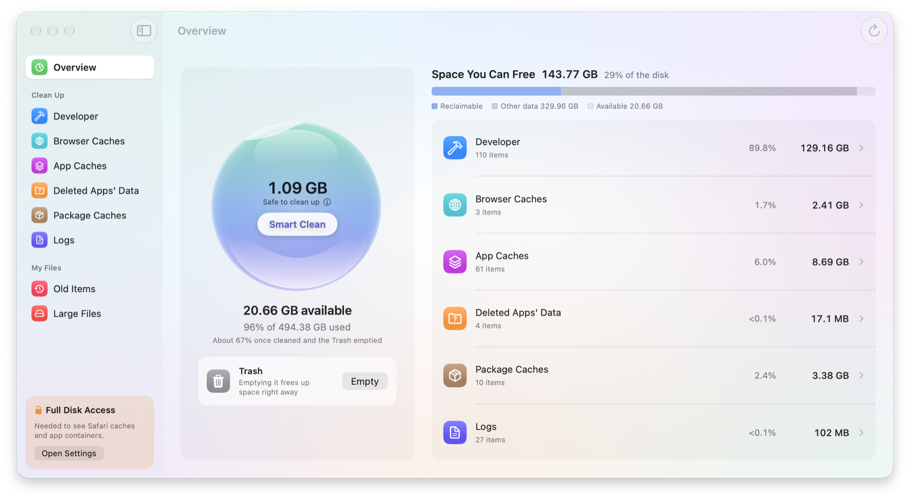
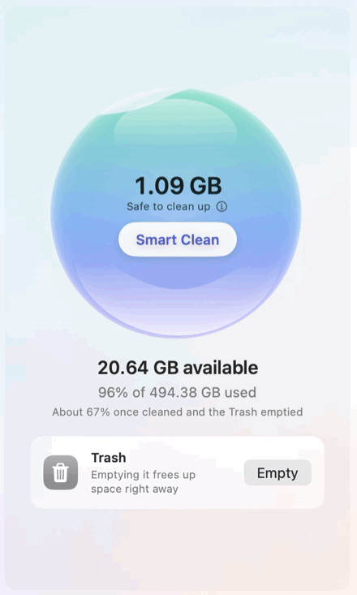
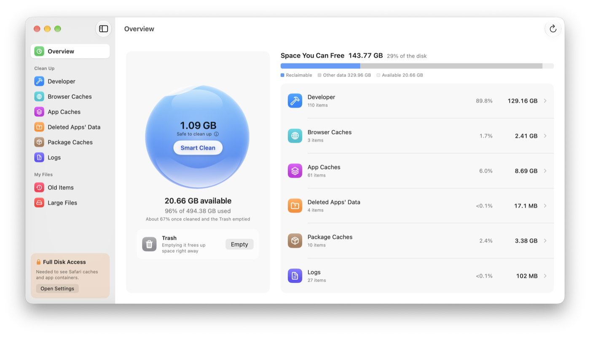
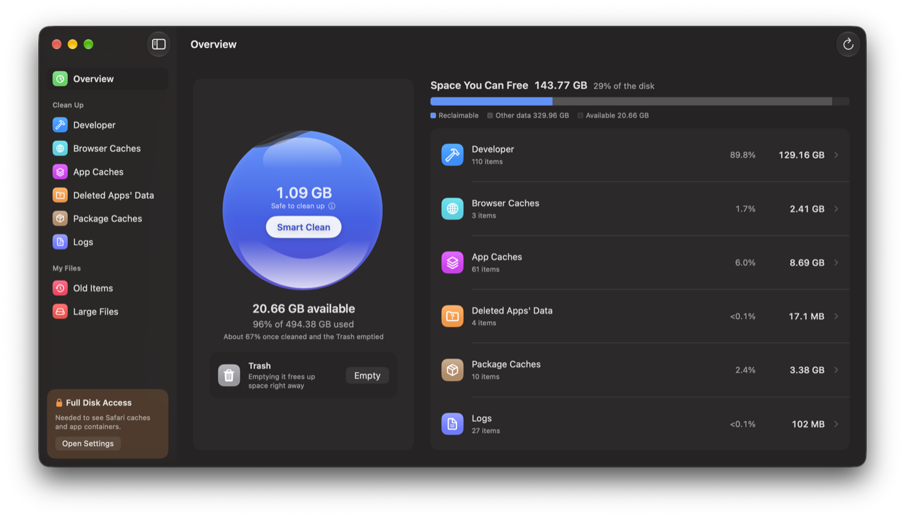

<p align="center">
  
</p>

<h1 align="center">Shubi</h1>

<p align="center">
  <strong>Swoosh your Mac's disk clean: find the caches and leftovers that pile up, and free the space.</strong>
</p>

<p align="center">
  <a href="https://github.com/MuchanKim/Shubi/releases"></a>
  <a href="#download"></a>
  <a href="#build-from-source"></a>
  <a href="https://github.com/airbnb/lottie-spm"></a>
  <a href="LICENSE"></a>
</p>

<p align="center">
  <a href="https://github.com/MuchanKim/Shubi/releases">Releases</a> ·
  <a href="#quick-start">Quick start</a> ·
  <a href="#what-gets-deleted">What gets deleted</a> ·
  <a href="#build-from-source">Build from source</a>
</p>

<p align="center">
  
</p>

Shubi scans the places where a Mac quietly fills up — Xcode build data, simulators, browser and app caches, package manager downloads, old logs, data left behind by deleted apps, and the conversations, generated files and caches AI tools keep — and shows how much each one costs. One tap on **Smart Clean** removes what apps rebuild on their own; everything else is listed for you to review.

Why Shubi? Its maker loves the Shrimp Beef Burger at McDonald's Korea, known there as the *Shubi* burger.

## See it in action

<p align="center">
  
</p>

*Captured from the running app: on a rescan the orb starts empty and fills as each section is found, and the total counts up with it.*

## Features

| Feature | What it does |
| --- | --- |
| **Disk at a glance** | Disk usage as water in a glass orb, one bar for reclaimable, other and free space, and each section's share. |
| **Smart Clean** | Deletes, in one tap, only caches and build data that apps make again, and the SwiftUI preview and parallel test simulators Xcode recreates. The ⓘ next to it says what it takes. |
| **Developer data** | DerivedData (Xcode's and XcodeBuildMCP's), archives, device support files, simulators, runtimes and their dyld caches, SwiftUI preview and parallel test simulators. |
| **Caches** | Browser caches, app caches including Electron apps', and Homebrew, npm, Yarn, pnpm, Bun, pip, CocoaPods, Go, SwiftPM and Playwright downloads. |
| **Leftovers and logs** | Data folders of apps you've deleted, and logs untouched for 30 days. |
| **Your own files** | Apps and documents you haven't opened in a while, and large files, listed for review only. |
| **AI tools** | Conversations, generated images, caches and logs that Claude Code, Codex, Gemini CLI, Antigravity, Cursor, T3 Code and Aside keep, by tool and kind, including what deleted tools left behind. Settings, credentials and databases are never offered for deletion. |
| **Inspector** | What each item is, who uses it, and what deleting it would cost. |
| **Themes and languages** | System, Light, Dark and Aurora. English and Korean, switched live without restarting. |

<p align="center">
  
  
</p>

## What gets deleted

A cleaner earns trust by what it leaves alone.

- **Smart Clean** takes only caches and build data that apps and tools rebuild, plus the SwiftUI preview simulators and parallel test clones that Xcode recreates. It scans again first and skips anything in use: caches of running apps and of apps sharing them (Firefox editions), DerivedData and the SwiftPM cache while Xcode or a command-line build (`xcodebuild`, `swift build`) runs, and Playwright's browsers while any Node process runs. XcodeBuildMCP's builds stay out of it, since the app it built may still be running, and so do simulator dyld caches, which take minutes to rebuild. It deletes permanently, so the space comes back at once.
- **Everything else** goes through a confirmation sheet. Files — archives, app data, your own files — move to the Trash by default. Simulators, runtimes and package caches with their own cleanup command (`simctl`, `brew cleanup`, `npm cache clean`, …) are removed by that command and skip the Trash; the sheet says so.
- **File deletion is allow-listed by kind** (`Cleaner.isAllowed`): a cache only inside the caches, build data only inside Xcode's folders, an app's data only as a whole data folder, and your documents only as your own files. A cache folder that links into your documents or another app's data can't take them with it.
- **AI tools' data is allow-listed per tool.** Shubi deletes only the paths it names for each tool — sessions, generated files, caches and logs — never their settings, credentials, skills or databases, and never through Smart Clean. Folders it can't vouch for (an unknown tool's sessions, a tool's own state, anything unreadable or linked elsewhere) are shown for review only. Right before deleting it checks each session again and skips one written to in the last ten minutes or grown since the scan.
- **One deletion at a time**, across Smart Clean, delete sheets and emptying the Trash in every window, and every screen refreshes when it ends.

## Download

**Requires macOS 26 or later.**

Download the latest notarized build from [GitHub Releases](https://github.com/MuchanKim/Shubi/releases/latest), unzip it and move Shubi to Applications. Shubi checks for updates once a day; **Check for Updates…** in the app menu checks now.

Full Disk Access is optional. Without it, Safari's caches and sandboxed apps' containers aren't scanned; the sidebar shows how to grant it.

## Quick start

1. Open Shubi. The overview scans every cleanup section and shows what can be freed; Old Items, Large Files and AI Tools are scanned when you open them.
2. Click **Smart Clean** to clear rebuildable caches in one tap.
3. Open a section in the sidebar to review the rest, check the inspector, and delete what you choose.
4. Empty the Trash from the overview when you're sure.

## Build from source

Use Xcode with the macOS 26 SDK or later. The app target uses **Swift 6 language mode** with default main-actor isolation; builds use **Xcode 27**.

1. Clone this repository and open `Shubi.xcodeproj`.
2. Let Swift Package Manager resolve [Lottie](https://github.com/airbnb/lottie-spm).
3. Select the **Shubi** scheme and **My Mac**.
4. Choose your own development team in **Signing & Capabilities**, then run the app.

Run the tests in both languages from the repository root:

```sh
xcodebuild -project Shubi.xcodeproj -scheme Shubi -destination 'platform=macOS' -testLanguage en test
xcodebuild -project Shubi.xcodeproj -scheme Shubi -destination 'platform=macOS' -testLanguage ko test
```

## Project layout

```
Shubi/
  App/            Entry point, main window, sidebar sections
  Scanning/       Scanners, scan items and their facts, the shared scan cache
  Cleaning/       Deletion policy (allow-list, Trash or permanent) and the cleanup coordinator
  Localization/   Live language switching
  Design/         Spacing, themes, per-theme colors
  Views/          Summary, section screens, settings, shared views
  Resources/      Assets, Lottie files, string catalogs, credits
ShubiTests/       Swift Testing suites
```

## Contributing

Issues and pull requests are welcome. See [CONTRIBUTING.md](CONTRIBUTING.md) for how to report a bug, what changes that delete files need, and how to open a pull request.

## License

Shubi is available under the [MIT License](LICENSE).

The disk animation and Lottie come with their own licenses; see [THIRD_PARTY_NOTICES.md](THIRD_PARTY_NOTICES.md). The app shows the same notices in **About Shubi**.
